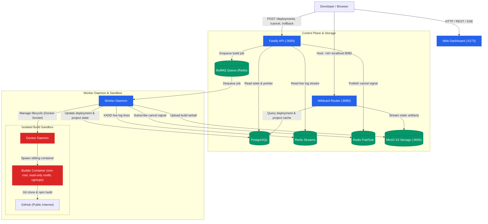

# DeployService Architecture

## Overview

DeployService is an open-source, self-hosted deployment platform inspired by Vercel and Netlify. It accepts public Git repositories, builds them inside isolated, resource-constrained Docker containers, stores static build artifacts in an S3-compatible object store (MinIO), and serves them through a wildcard reverse-proxy router supporting both immutable preview subdomains and atomic project production releases.

---

## Core System Components

### 1. API Server (`apps/api`)

- **Technology**: Fastify on Node.js 20.
- **Port**: `3000` (bound to `127.0.0.1` on host).
- **Authentication**: Constant-time `x-api-key` header verification for sensitive mutations (`POST /deployments`, `GET /deployments`, `POST /deployments/:id/cancel`, `POST /projects/:id/rollback`).
- **Input Validation**: Strict SSRF prevention rejecting non-GitHub domains, internal IPs (IPv4/IPv6, localhost, AWS metadata `169.254.169.254`), embedded userinfo, shell metacharacters, and leading hyphens.
- **Rate Limiting**: Enforces 10 requests/minute per client IP via `@fastify/rate-limit`.
- **Live Logs (SSE)**: Serves Server-Sent Events at `GET /deployments/:id/logs` reading from Redis Streams with numeric `(ms, seq)` ID resumption and automatic catch-up buffering. Serves raw logs (`?format=raw`) from MinIO archive once builds complete.

### 2. Worker Engine (`apps/worker`)

- **Technology**: Node.js worker consuming BullMQ jobs with concurrency limit (`MAX_CONCURRENT_BUILDS=2`).
- **Failure Classification**:
  - `UserBuildError`: syntax errors, test failures, non-zero exit codes, cgroup OOM kills, and build timeouts throw BullMQ's `UnrecoverableError` (no wasteful retries).
  - `InfrastructureError`: transient Docker socket failures, MinIO write timeouts, or Postgres connection drops retry with exponential backoff up to 3 attempts.
- **Supervisor Recovery**: Runs on startup and periodically every 60s. Detects deployments stuck in `cloning`, `building`, or `uploading` that are not actively running in memory, not queued in BullMQ, and older than the build timeout, marking them `failed` and reaping orphaned Docker containers/volumes.
- **Cancellation Listener**: Listens on Redis pub/sub channel `deployservice:cancel`. When a cancel signal arrives for an active build, forcefully terminates the container (`docker.kill()`), transitions state to `cancelled`, and emits exit code 130 to the Redis stream.
- **Periodic Maintenance**: Reaps orphaned containers and volumes older than 1 hour and sets 24-hour expiration (`EXPIRE 86400`) on Redis log streams.

### 3. Container Build Sandbox (`docker/builder`)

- **Base Image**: Alpine Linux 3.19 with Node.js 20, pnpm, and Git.
- **Least Privilege Execution**:
  - Non-root user: `builduser` (`UID 10001:10001`).
  - Read-only root filesystem (`ReadonlyRootfs: true`).
  - Dropped Linux capabilities: `CapDrop: ["ALL"]`.
  - Security options: `no-new-privileges: true`.
- **Resource Constraints (cgroups)**:
  - Memory limit: 512MB RAM with strict swap disabling (`MemorySwap: 536870912`).
  - CPU quota: 1.0 vCPU (`NanoCpus: 1_000_000_000`).
  - PID limit: 100 max processes (`PidsLimit: 100`) to prevent fork bombs.
  - Wall-clock timeout: 5 minutes (`BUILD_TIMEOUT_MS=300000`).
- **Network Isolation**:
  - Dedicated bridge network (`deployservice-build-net`) with internal routing.
  - Production compose does not publish database or cache ports to the host interface.

### 4. Edge Router (`apps/router`)

- **Technology**: Fastify wildcard HTTP proxy.
- **Port**: `8080` (bound to `127.0.0.1` on host).
- **Dual Routing Architecture**:
  - **Preview Releases**: `http://<deploymentId>.localhost:8080` routes to a specific immutable build (`d-[a-f0-9]{32}`).
  - **Production Releases**: `http://<projectId>.localhost:8080` dynamically resolves to the project's current active deployment (`projects.current_deployment_id`).
- **In-Memory LRU Cache**: Caches deployment records and project pointers with a 5-second TTL to reduce database lookup overhead during traffic spikes.
- **Static Artifact Streaming**: Streams files directly from MinIO with accurate MIME types, security headers, ETag generation, and client-side SPA fallback (`index.html`).

### 5. Web Dashboard (`apps/web`)

- **Technology**: React 18, Vite, Tailwind CSS.
- **Port**: `5173` (bound to `127.0.0.1` on host).
- **Features**:
  - Real-time deployments list with color-coded status badges and automated refresh.
  - Detail view with live terminal log streaming and auto-scroll control.
  - One-click cancellation for queued or building jobs.
  - One-click instant rollback for deployed project releases.
  - Direct links to Preview subdomains and Project production releases.

---

## End-to-End Operational Workflows

### 1. Build & Deploy Lifecycle

1. User submits repository URL via `POST /deployments` with `x-api-key`.
2. API validates repo URL format, creates or retrieves project row, inserts deployment in `queued` status, and pushes job to BullMQ.
3. Worker picks up job, marks deployment `cloning`, and starts ephemeral container on `deployservice-build-net`.
4. Container runs `build-entrypoint.sh`: clones repo at shallow depth (`--depth=1`), detects framework (Vite, Next.js, Create React App, Astro, static), executes build command, and writes artifacts to `/build/output`.
5. Worker extracts build directory from container as a tar stream, extracts files, uploads each object to MinIO under `deployments/<id>/*`, and cleans up Docker resources.
6. Worker transitions status to `deployed`, atomically updates `projects.current_deployment_id`, and writes final `end` marker to Redis stream.

### 2. Live Log Streaming & Resumption

1. API receives client connection at `GET /deployments/:id/logs`.
2. API validates deployment ID, sets SSE headers (`text/event-stream`, `Cache-Control: no-cache`), and inspects `Last-Event-ID` header.
3. If `Last-Event-ID` is present, API queries `XRANGE` from that ID forward to deliver any missed lines before joining live streams.
4. Dedicated `XREAD BLOCK` loop reads Redis stream entries in real time, buffers lines, and flushes to SSE clients.
5. On build termination, worker appends an `end` event with final exit code. API closes SSE connections cleanly.

### 3. Atomic Release & Rollback Flow

1. Projects maintain a single pointer `current_deployment_id`.
2. When a deployment succeeds, `current_deployment_id` is updated in a Postgres transaction. Past deployments remain immutable.
3. User triggers rollback via `POST /projects/:id/rollback` specifying an optional `targetDeploymentId`.
4. API verifies deployment ownership and status (`deployed`), and atomically flips `current_deployment_id`.
5. The edge router resolves `http://<projectId>.localhost:8080` to the newly active deployment immediately upon cache expiry.
